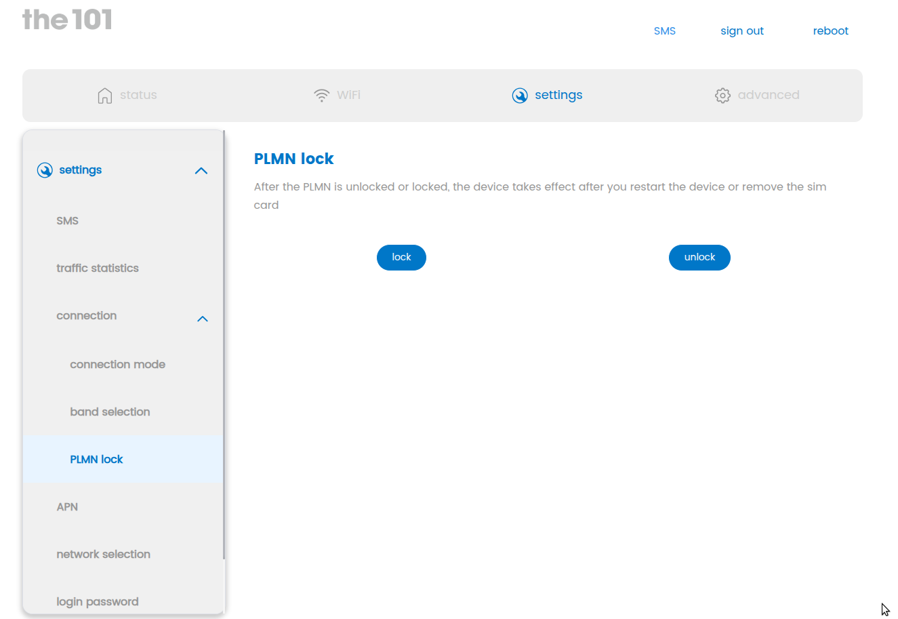

# Globe AT HOME 5G WIFI (rain101 / the101) — Openline & Harden

> **One command unlocks your router for any SIM and removes the carrier's remote control + hidden backdoors.** Works from an Android phone, Mac, Linux, or Windows.



---

## ✅ Is this the right router? The script checks for you

This tool is built for **one** device only:

| Device | Globe AT HOME 5G WIFI (a.k.a. rain101 / the101) |
|---|---|
| **Firmware** | `RA_M1_v7.00.02g` · **Hardware** V1.0 · **IP** `192.168.0.1` |

**You don't have to check anything yourself.** When you run the command below, the script automatically detects your router's firmware **and stops safely — before changing anything — if it's not the supported model.** So it's safe to just try it.

> ❌ It will refuse to run on other Globe/rain models (Prepaid WiFi, Streamwatch, rain 5G, rain ONE) or newer firmware (`v7.2.02g`+). Nothing is modified when it refuses.

---

## ✅ QUICK START — 3 steps

You do **not** need to be a coder. Three steps, about 2 minutes.

### 1️⃣ Connect to the router and turn OFF mobile data

- Connect your phone/computer **Wi-Fi** to the router's network.
- **Turn mobile data OFF** (so your device talks to the router, not the internet).

### 2️⃣ Find your admin password

👉 **It's printed on the sticker underneath the router.** (The script will ask you for it.)

### 3️⃣ Run the ONE line for your device

**📱 Android** — first install **Termux** from [F-Droid](https://f-droid.org/packages/com.termux/) (not the Play Store), open it, and run `pkg install -y python` once. Then:

```bash
curl -fsSL https://raw.githubusercontent.com/jobrac/openline-101/main/install.sh | sh
```

**🍎 Mac / 🐧 Linux** — just run:

```bash
curl -fsSL https://raw.githubusercontent.com/jobrac/openline-101/main/install.sh | sh
```

**🪟 Windows** — open **PowerShell** and run:

```powershell
irm https://raw.githubusercontent.com/jobrac/openline-101/main/install.ps1 | iex
```

> These bootstrap scripts find Python for you — they try `python3`, then `python` (Windows also tries `py`), check the version, and tell you how to install it if it's missing. **Already have Python 3?** You can skip the bootstrap and pipe the tool directly: `curl -fsSL https://raw.githubusercontent.com/jobrac/openline-101/main/openline.py | python3 -`

---

**That's it.** The script will:
1. Ask for your admin password → type it (or paste) and press Enter.
2. Unlock the SIM, enable access, and harden the router — you'll see ✅ lines go by.
3. Ask **"Reboot now? (y/N)"** → type **`y`** and press Enter.

When it finishes you'll see **🎉 Your the101 router is openline and hardened.**

> 💡 You don't install anything except Python — the whole tool is a single file. On Windows, if you don't have Python, the command above downloads a ready-made `openline.exe` automatically.

---

## 🤔 What does it actually do?

In plain words, after you run it:

- 📶 **Any SIM works** — the carrier (PLMN) lock is removed.
- 🔒 **The carrier can't remote-control your router** — TR-069 remote management is killed.
- 🚪 **Hidden factory backdoors are closed** — telnet, ADB-over-USB, manufacturer SSH keys, and exposed test ports.
- 📡 **It stops phoning home** — cloud telemetry / tracking / auto-firmware-update services are blocked.
- 📺 **Your LCD screen still works** — only the cloud link is cut, not the display.
- 🔧 **You get full admin access** — SSH + the hidden developer pages in the web UI.

It survives a reboot. (It does **not** survive a factory reset or a firmware upgrade — see the warnings below.)

---

## 🆘 If something goes wrong

| What you see | What to do |
|---|---|
| **"Can't reach the router"** | You're not on the router's Wi-Fi, or mobile data is still on. Reconnect Wi-Fi, turn mobile data OFF, try again. |
| **"login failed — wrong password"** | The admin password is on the sticker under the router. Try `admin123` as a fallback. More ways to find it → [Advanced Guide](docs/ADVANCED.md#finding-your-admin-password). |
| **`python3: command not found`** (Android) | Run `pkg install -y python` in Termux first. |
| **`python` opens the Microsoft Store** (Windows) | The `install.ps1` command handles this for you — use it instead of running `python` directly. |
| **Web UI looks broken afterward** | See [Recovery](docs/ADVANCED.md#recovery-if-the-web-ui-breaks) in the Advanced Guide. |

---

## ⚠️ Two important warnings

- **Do NOT factory reset** unless you mean to undo everything — it wipes the unlock. (You can re-run this script afterward to redo it.)
- **Do NOT upgrade the firmware** — an update from Rain/Globe will remove the unlock and may block it permanently.

After it's done, it's good practice to **change the root password** (the script sets a default): `ssh root@192.168.0.1` then `passwd`.

---

## 📚 More documentation

| Guide | For whom |
|---|---|
| **[Advanced Guide →](docs/ADVANCED.md)** | Power users: command-line options, manual `curl`/ubus API, hidden developer pages, recovery, reverting changes, re-enabling after a reset, and rebuilding the embedded script. |
| **[Security & Audit Reference →](docs/AUDIT.md)** | Auditors/reviewers: exactly what the tool changes on the device, how the unlock and hardening work internally, the backdoors it removes, and commands to verify every claim. |

---

## 📦 What's in this repo

```
├── README.md            ← you are here (simple quick start)
├── openline.py          ← the one self-contained tool (run this)
├── install.sh           ← Android/Mac/Linux one-liner bootstrap (finds Python)
├── install.ps1          ← Windows one-liner bootstrap (finds Python, or grabs the .exe)
├── harden.sh            ← the hardening routine (embedded into openline.py)
├── binaries/            ← pre-patched router files (embedded into openline.py)
│   └── RA_M1_v7.00.02g/
├── tools/
│   ├── build_openline.py   ← re-embeds harden.sh + binaries after you edit them
│   └── windows-build.bat   ← builds the standalone openline.exe
└── docs/
    ├── ADVANCED.md      ← power-user guide
    └── AUDIT.md         ← security / auditor reference
```

To run the tool you only need **`openline.py`** (everything else is embedded inside it). The other files are for maintainers and for people who want to understand or rebuild it.

---

## 🙏 Credits

- **PHCorner community** — firmware dumps and early analysis.
- **DeepSeek** — AI model used during reverse engineering and Lua patching.
- **The OpenWRT project** — the router's base OS and the ubus/LuCI architecture that made this possible.
